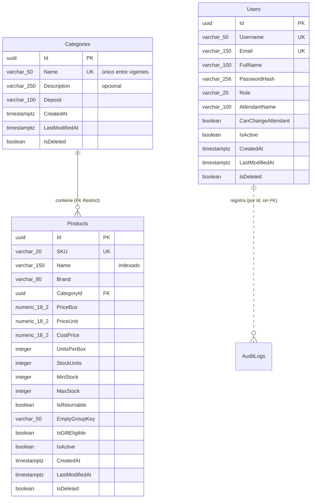

# Modelo de datos: dimensiones del dominio y diccionario de datos

Este documento responde al requisito 4 de la Fase 5: el análisis de las cuatro dimensiones operacionales y el diccionario de datos de las tablas `Categories`, `Products` y `Users`.

El esquema sale de la base real (PostgreSQL 15). Se genera con las migraciones de EF Core en `src/backend/Infrastructure/Persistence/Migrations` y está exportado en [`docs/fase2/schema.sql`](fase2/schema.sql). Para consultarlo desde pgAdmin (http://localhost:5050): Servers, Distribución Polar, Schemas, public, Tables.

## 1. Las cuatro dimensiones operacionales

El curso propone los atributos de una ferretería. En una distribuidora de bebidas y alimentos, cada dimensión se cubre con los datos que el negocio usa de verdad:

| Dimensión | Atributos del curso | Atributos en Distribución Polar | Impacto operacional y financiero |
| --- | --- | --- | --- |
| **1. Identificación Comercial** | Nombre comercial, SKU único, marca, código de barras (EAN-13) | `Products.Name`, `Products.Brand` y `Products.SKU` (único, formato `[CAT]-[PRO]-[SEQ]`, generado por el sistema con `CorporateSkuGenerator`). La categoría (`Categories.Name`) agrupa el catálogo | Búsqueda indexada por SKU (índice único, B-Tree) y por nombre. El SKU sale de la categoría y del nombre, así que no lo escribe nadie a mano |
| **2. Gestión Financiera** | Costo unitario, precio de venta, margen bruto | `Products.CostPrice` (costo por caja), `Products.PriceBox` y `Products.PriceUnit` (precio de venta por caja y por unidad, independientes), todos `numeric(18,2)` | Valorización del inventario al costo frente al precio de venta, y margen bruto proyectado en el dashboard ([ADR 41](04-DECISIONES.md#41-dashboard-kpi-calculado-en-la-capa-de-aplicación)). Las facturas guardan una copia de los precios del momento |
| **3. Control/Umbrales de Stock** | Stock físico, stock mínimo, capacidad máxima | `Products.StockUnits` (galpón, en unidades), `Products.MinStock` y `Products.MaxStock` (`MaxStock > MinStock` por check constraint). El stock de cada camión está en `TruckStock` | Alertas del dashboard: agotado, bajo el mínimo, bajo, óptimo, en el tope y sobre el máximo (`ProductHealthEvaluator`), con las unidades a reponer |
| **4. Logística/Almacén** | Ubicación física, unidad de medida | Ubicación: `Categories.Deposit` (depósito del galpón por categoría) y `TruckStock` (qué camión lleva cada producto). Unidad de medida: caja de `Products.UnitsPerBox` unidades, más unidades sueltas. Capacidad de la flota: `Trucks.CapacityBoxes` | Despacho desde el galpón o desde un camión, carga de camiones y ocupación de la flota. Las cantidades se capturan en cajas y unidades y se guardan en unidades (`BoxQuantity`) |

### Columnas reales por dimensión

| Dimensión | Tabla.Columna | Tipo | Regla |
| --- | --- | --- | --- |
| **Identificación Comercial** | `Products.SKU` | `varchar(20)` | Índice único `IX_Products_SKU`, generado por el sistema |
| | `Products.Name` | `varchar(150)` | Obligatorio; índice `IX_Products_Name` |
| | `Products.Brand` | `varchar(80)` | Obligatorio |
| | `Products.CategoryId` → `Categories.Name` | `uuid` → `varchar(50)` | FK `Restrict`; nombre de categoría único entre vigentes |
| | `Products.IsActive` | `boolean` | Habilitado en el catálogo |
| **Gestión Financiera** | `Products.CostPrice` | `numeric(18,2)` | Costo por caja, ≥ 0 |
| | `Products.PriceBox` | `numeric(18,2)` | Precio de venta por caja, > 0 |
| | `Products.PriceUnit` | `numeric(18,2)` | Precio de venta por unidad, > 0 |
| | (calculado) margen bruto | — | Venta − costo, en el dashboard |
| **Control/Umbrales de Stock** | `Products.StockUnits` | `integer` | Existencia en galpón, ≥ 0 |
| | `Products.MinStock` | `integer` | Stock mínimo de seguridad |
| | `Products.MaxStock` | `integer` | Capacidad máxima; check `MaxStock > MinStock` |
| | `TruckStock.StockUnits` | `integer` | Existencia en cada camión, > 0 |
| **Logística/Almacén** | `Categories.Deposit` | `varchar(100)` | Ubicación: depósito del galpón |
| | `Products.UnitsPerBox` | `integer` | Unidad de medida: caja de N unidades, > 0 |
| | `TruckStock (TruckId, ProductId)` | PK compuesta | Qué camión lleva cada producto |
| | `Trucks.CapacityBoxes` | `integer` | Capacidad de carga en cajas (1–5000) |

**Atributo del curso que no se modela:** el código de barras EAN-13. La distribuidora identifica los productos por SKU y nombre; ningún proceso (facturación, compras ni inventario) lee códigos de barras. Si se agrega un lector, la columna sería `Products.Barcode varchar(13)` con un índice único parcial.

## 2. Diagrama entidad-relación

## 3. Diccionario de datos

Convenciones de todas las tablas:
- Claves primarias UUID generadas por la aplicación. Los datos de la siembra usan UUID fijos para que las migraciones sean deterministas.
- Fechas en `timestamptz` (UTC).
- Borrado lógico con `IsDeleted` y un filtro global de EF Core.
- Concurrencia optimista con la columna de sistema `xmin`: una actualización simultánea responde 409.

### Categories

| Columna | Tipo | Nulo | Restricciones y reglas de negocio |
| --- | --- | --- | --- |
| `Id` | `uuid` | No | **PK** (`PK_Categories`) |
| `Name` | `varchar(50)` | No | **Índice único parcial** `IX_Categories_Name` (`WHERE "IsDeleted" = false`): no se repite entre categorías vigentes |
| `Description` | `varchar(250)` | Sí | Opcional |
| `Deposit` | `varchar(100)` | No | Depósito del galpón donde se guardan los productos de la categoría (dimensión logística) |
| `CreatedAt` | `timestamptz` | No | Auditoría, UTC |
| `LastModifiedAt` | `timestamptz` | Sí | Última modificación |
| `IsDeleted` | `boolean` | No | Por defecto `false`. Solo se elimina si no tiene productos |

Relaciones: 1 a N con `Products`.

### Products

| Columna | Tipo | Nulo | Restricciones y reglas de negocio |
| --- | --- | --- | --- |
| `Id` | `uuid` | No | **PK** (`PK_Products`) |
| `SKU` | `varchar(20)` | No | **Índice único** `IX_Products_SKU`. Formato `[CAT]-[PRO]-[SEQ]`, generado por el sistema |
| `Name` | `varchar(150)` | No | Índice `IX_Products_Name` para la búsqueda y el orden |
| `Brand` | `varchar(80)` | No | Marca comercial |
| `CategoryId` | `uuid` | No | **FK** `FK_Products_Categories_CategoryId` → `Categories(Id)` con `ON DELETE RESTRICT`; índice `IX_Products_CategoryId` |
| `PriceBox` | `numeric(18,2)` | No | Precio de venta por caja. Check `CK_Products_PriceBox_Positive` (> 0) |
| `PriceUnit` | `numeric(18,2)` | No | Precio de venta por unidad suelta, independiente del de la caja. Check `CK_Products_PriceUnit_Positive` (> 0) |
| `CostPrice` | `numeric(18,2)` | No | Costo por caja. Check `CK_Products_CostPrice_NotNegative` (≥ 0) |
| `UnitsPerBox` | `integer` | No | Unidades por caja (unidad de medida). Check `CK_Products_UnitsPerBox_Positive` (> 0) |
| `StockUnits` | `integer` | No | Existencia en galpón, en unidades. Por defecto 0. Check `CK_Products_StockUnits_NotNegative` (≥ 0) |
| `MinStock` | `integer` | No | Stock mínimo de seguridad, en unidades |
| `MaxStock` | `integer` | No | Capacidad máxima, en unidades. Check `CK_Products_MaxStock_GreaterThan_MinStock` (`MaxStock > MinStock`) |
| `IsReturnable` | `boolean` | No | Envase retornable (informativo). Por defecto `false` |
| `EmptyGroupKey` | `varchar(50)` | Sí | Grupo de vacíos (`RET_222ML_X36`, `RET_POLAR_PILSEN_330ML_X24`, `PEPSI_125L_X6`, `PEPSI_350ML_X24`). Solo los productos con grupo generan vacíos |
| `IsGiftEligible` | `boolean` | No | Autorizado para regalías a clientes. Por defecto `false` |
| `IsActive` | `boolean` | No | Habilitado para la venta |
| `CreatedAt` | `timestamptz` | No | Auditoría, UTC |
| `LastModifiedAt` | `timestamptz` | Sí | Última modificación |
| `IsDeleted` | `boolean` | No | Borrado lógico. Las facturas conservan su copia del producto |

Relaciones: N a 1 con `Categories`; 1 a N con `TruckStock`, `TruckLoads`, `InvoiceItems`, `PurchaseItems`, `ConsignmentItems`, `DamagedProducts` e `InternalConsumptions` (todas con `Restrict`).

### Users

| Columna | Tipo | Nulo | Restricciones y reglas de negocio |
| --- | --- | --- | --- |
| `Id` | `uuid` | No | **PK** (`PK_Users`). Viaja en el claim `sub` del JWT |
| `Username` | `varchar(50)` | No | **Índice único** `IX_Users_Username`. Se guarda normalizado (minúsculas, sin espacios) |
| `Email` | `varchar(150)` | No | **Índice único** `IX_Users_Email`. Se guarda en minúsculas; también sirve para iniciar sesión |
| `FullName` | `varchar(100)` | No | Nombre para mostrar (claim `name`) |
| `PasswordHash` | `varchar(256)` | No | PBKDF2-HMAC-SHA256 con sal ([ADR 18](04-DECISIONES.md#18-claves-con-pbkdf2-hmac-sha256)). La clave nunca se guarda en claro |
| `Role` | `varchar(20)` | No | Enum guardado como texto: `Admin` o `Employee` (claim `role`, RBAC) |
| `AttendantName` | `varchar(100)` | Sí | Vendedor fijo que figura en las facturas del usuario |
| `CanChangeAttendant` | `boolean` | No | Si puede elegir otro vendedor al facturar. Por defecto `false` |
| `IsActive` | `boolean` | No | Un usuario inactivo no puede iniciar sesión |
| `CreatedAt` | `timestamptz` | No | Auditoría, UTC |
| `LastModifiedAt` | `timestamptz` | Sí | Última modificación |
| `IsDeleted` | `boolean` | No | Por defecto `false`. Los usuarios se desactivan, no se eliminan |

Relaciones: `AuditLogs.UserId` guarda el Id del usuario que hizo cada operación. No es una FK: la bitácora debe sobrevivir aunque el usuario cambie.

## 4. Otras tablas

Las tablas de la operación (camiones, clientes, facturas, compras, averías, consumos, consignación, auditoría y contadores) están resumidas en [Arquitectura §8](02-ARQUITECTURA.md#8-persistencia). La que alimenta la dimensión logística es `Trucks`:

| Columna | Tipo | Restricciones |
| --- | --- | --- |
| `Id` | `uuid` | PK |
| `Name` | `varchar(50)` | Obligatorio |
| `Plate` | `varchar(20)` | Índice único parcial entre vigentes |
| `Status` | `varchar(30)` | "En galpón" |
| `CapacityBoxes` | `integer` | Capacidad de carga en cajas, por defecto 500. Check `CK_Trucks_CapacityBoxes_Range` (1 a 5000). Base del KPI de ocupación de flota |
